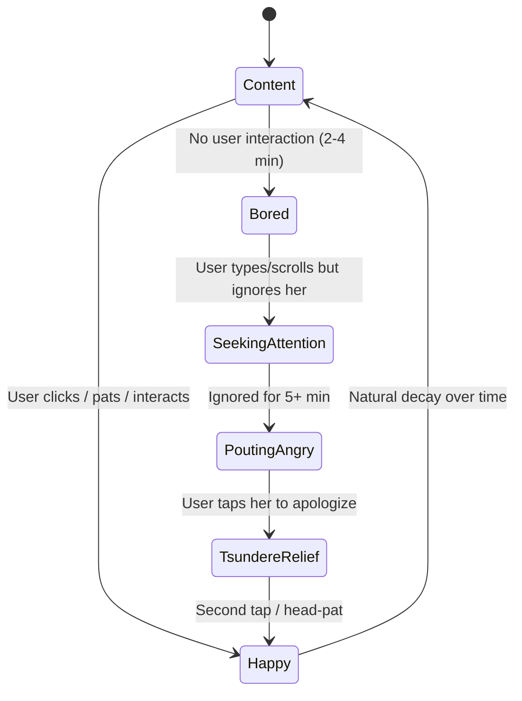

# Autonomous Companion Behavior & Voice Engine Architecture (100% Code-Driven)

This blueprint outlines how to build an **autonomous, personality-driven companion brain** for both 2D and 3D modes using pure deterministic logic, browser APIs, and state machines—with **zero AI, zero cloud dependencies, and 0ms latency**.

---

## 1. The Autonomous "Brain" (Deterministic Emotional State Machine)

Instead of LLMs, we implement an **Emotional Finite State Machine (EFSM)** driven by real-time interaction metrics:

### Core Dynamic Meters
1. **`attentionMeter` (0–100, default: 75)**
   - **Drains** when the user is actively working/browsing but doesn't interact with her.
   - **Fills** on click, double-click (pat), dragging, or clicking her speech bubble.
2. **`affectionMeter` (0–100, persistent in `chrome.storage`)**
   - Tracks long-term bond. Higher affection unlocks sweeter quotes, faster apologies, and playful animations.
3. **`energyMeter` (0–100)**
   - Determines activity level: High energy = roaming/strolling; Low energy = tea sipping, daydreaming, sitting.

---

## 2. Emotional Behaviors & Reactions

| Mood State | Trigger Condition | Visual Appearance (3D VRM & 2D) | Behavior & Dialogue |
| :--- | :--- | :--- | :--- |
| **Happy / Cheerful** | High attention (>70) or recent interaction | Smiling eyes (`happy` expression), relaxed posture, cute bounce | Follows cursor with eyes, waves periodically, cheerful voice lines ("You're working so hard today~") |
| **Content / Calm** | Normal focus (40–70) | Natural micro-breathing, occasional blink, soft neutral gaze | Relaxed presence, sips tea, occasional stretch, doesn't interrupt |
| **Bored / Distracted** | No input for 3 mins | Glances around, inspects screen edges | Walks on her own across the bottom bar, sits down, hums |
| **Seeking Attention** | Low attention (20–40) while user is typing/scrolling | Slight head tilt, peeking pose, light hand tap | Taps on the screen border, pops subtle bubble ("Psst, remember me?", "Did you forget I'm right here?") |
| **Pouting / Angry** | Very low attention (<20) | Crossed arms, furrowed brow (`angry` + `sad` blendshape), turned away | **Refuses to follow cursor**, turns back slightly, puffs cheeks ("Hmph! Ignore me all you want!"). |
| **Tsundere Apology** | Tapped while Pouting | Surprised wide eyes (`surprised` -> `relaxed`), blushing | Sudden reaction: "D-don't think a quick tap fixes everything! ...Though I did miss you." |

---

## 3. Autonomous Movement & World Awareness

Even without AI, rich scripted routines make her feel alive:

1. **Autonomous Roaming**:
   - Periodic roll (every 25–60s): She decides whether to stay put, stroll to a random position along the bottom screen, or look out the window.
   - Smooth easing walk cycle with turnarounds at screen margins.
2. **Webpage Interaction**:
   - **Fast Scroll Reaction**: If user scrolls rapidly, she steadies herself with a light balance pose.
   - **Tab Switching**: Welcomes you back when switching back to the tab.
   - **Smart Work Mode**: During active Pomodoro focus sessions, she automatically suppresses angry pouting so she never distracts you during deep work.

---

## 4. Voice & Speech Architecture (Browser-Native, 0 Cost)

### A. Web Speech API (`window.speechSynthesis`)
- **Zero latency, 100% offline**: Uses the system's built-in high-quality female TTS voices (e.g. Chrome Natural / Microsoft Aria / Google US English).
- **Custom Voice Pitch & Rate**:
  - Seraphina: Pitch `1.15`, Rate `1.02` (elegant, gentle, poised tone).
  - Crimson: Pitch `1.30`, Rate `1.08` (spirited, lively, playful anime tone).
- **Configurable Speech Audio**: User can toggle voice On/Off or Mute in popup settings.

### B. Real-Time Procedural Lip-Sync
- While speaking, `SpeechSynthesisUtterance.onboundary` and procedural phoneme timing drive VRM mouth viseme shape keys:
  - Vowels: `aa`, `oh`, `ih`, `ee` blended with speech cadence.
  - Mouth automatically returns to neutral on speech completion.

### C. Procedural Audio SFX (Web Audio API)
- Lightweight synthesized chimes without external audio files:
  - Soft bell chime on tab greeting.
  - Cute pop sound on speech bubble.
  - Soft pout tone on angry state.

---

## 5. Next Steps & Customization Choices

1. **Pouting Frequency**: How quickly should she get jealous/want attention? (e.g. Mild after 10 mins, or Sassy after 3 mins?)
2. **Voice Preference**: Clean English female TTS voice, or cute Japanese/anime vocalizations?
3. **Sound FX**: Enable subtle Web Audio chime feedback on clicks and pokes?
