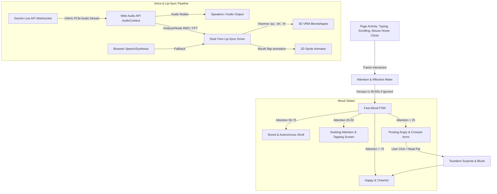

# Autonomous Fast-Mood Motion Brain & Gemini Live Voice System

This architecture integrates a **rapid-switching emotional behavior engine** and a **Gemini Live Multimodal Voice pipeline** directly into the Seraphina Chrome Companion.

---

## 1. System Architecture Overview



---

## 2. Fast-Changing Mood & Motion Engine

Unlike slow idle companions, this engine updates behavior on a **fast 10–25 second decision cycle**:

### Dynamic State Flow

| State | Cadence | 3D VRM Pose & Expressions | 2D Action Sprites | Dialogue & Spoken Lines |
| :--- | :--- | :--- | :--- | :--- |
| **Happy / Focused** | 15–25s | Soft smile (`happy` 0.4), eyes track cursor smoothly, relaxed breathing sway. | `idle`, `tea` | *"Everything's looking smooth! Keep it up~"* |
| **Wandering / Stroll** | 12–20s | Catwalk walk stride across screen bottom, pauses at random spots, head glance. | `walk_left` (strolling left & right) | Hum / calm footstep cues |
| **Attention-Seeking** | 10–15s | Waving hand, light hop, head tilted toward user with curious eyes (`surprised` 0.3). | `wave`, `celebrate` | *"Psst! Over here! Did you forget your companion?"* |
| **Pouting / Angry** | Persistent until clicked | **Furrowed angry brows** (`angry` 0.7), **turns torso away -35°**, **refuses to follow cursor**, arms crossed. | Pouting speech bubble, arms crossed stance | *"Hmph! Ignore me all you want! I don't care at all!"* |
| **Head-Pat Apology** | On Click / Double-Click | Sudden wide eyes (`surprised` 0.8), then blush & gentle relief (`relaxed` 0.6). | `idle_blink` + bounce | *"D-don't think a simple head-pat solves everything! ...Though it does feel nice."* |

---

## 3. Gemini Live Multimodal Voice Engine

### A. Real-Time Streaming Connection
- Connects via secure WebSocket to Gemini Live:
  ```
  wss://generativelanguage.googleapis.com/ws/google.ai.generativelanguage.v1alpha.GenerativeService.BidiGenerateContent?key=YOUR_API_KEY
  ```
- Uses model `models/gemini-2.0-flash-exp` with native low-latency audio output.
- **Voice Archetypes**:
  - **Aoede / Kore**: Warm, expressive, melodic feminine voice (Seraphina & Crimson).
  - **Puck**: Playful, lively, energetic tone.

### B. Real-Time Web Audio Lip-Sync
1. Server pushes audio frames encoded in linear 24kHz 16-bit PCM.
2. Web Audio `AudioContext` buffers and schedules seamless continuous playback.
3. An `AnalyserNode` taps the frequency domain:
   - Computes RMS vocal energy at 60 FPS.
   - Maps instantaneous volume directly to 3D VRM mouth shape keys (`aa`, `oh`, `ih`, `mouthOpen`) and 2D mouth frames.
   - When speech stops, mouth smoothly returns to neutral closed state with 0 clipping.

### C. Zero-Dependency Offline Fallback
- If Gemini Live is disconnected or no API key is set:
  - System automatically uses local browser `window.speechSynthesis` with tuned pitch (`1.22x`) and rate (`1.05x`).
  - Syllable boundaries (`utterance.onboundary`) trigger procedural mouth opening.

---

## 4. Proposed Implementation Files in Project

1. `content/brain-engine.js`: The fast-mood emotional state machine and autonomous wandering director.
2. `content/gemini-live.js`: WebSocket connection, PCM audio decoding, and Web Audio analyser node.
3. `popup/popup.html` & `popup.js`:
   - Gemini Live toggle & API key input field.
   - Voice selector dropdown (`Aoede`, `Kore`, `Puck`, `Fenrir`).
   - Sassy / Clingy slider (controls how fast she demands attention).
